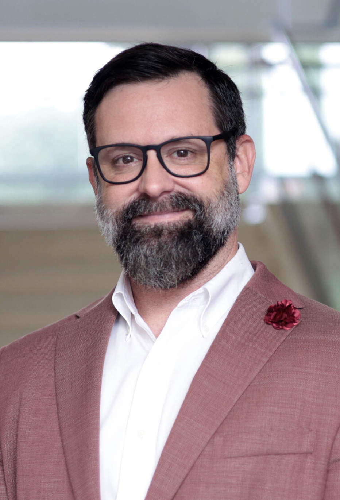

::: {.about-intro}

::: {.about-portrait}

{.about-headshot}

:::

::: {.about-summary}

## Grant B. Morgan, Ph.D.

### Quantitative Methodologist · Psychometrician · Research Leader

I am Professor of Quantitative Methods in the Department of Educational Psychology and Associate Dean for Research in Baylor University’s Moody School of Education.

My scholarship focuses on latent variable modeling, psychometrics, classification, validity, and evidentiary reasoning. Across these areas, I examine how research design, measurement, statistical models, and analytical decisions affect the quality of conclusions drawn from evidence.

[View My CV](assets/documents/grant-morgan-cv.pdf){.btn .btn-primary target="_blank"}

[Contact Me](contact.qmd){.btn .btn-outline-dark}

:::

:::

## Scholarly Identity

My work is unified by a commitment to supporting valid inference through rigorous research design, appropriate and accurate analysis, and strong evidentiary reasoning—particularly when quantitative conclusions inform consequential real-world decisions.

My primary areas of expertise include:

::: {.expertise-grid}

::: {.expertise-item}

### Latent Variable Modeling

Structural equation modeling, confirmatory factor analysis, mixture models, longitudinal models, model fit, estimation, and misspecification.

:::

::: {.expertise-item}

### Psychometrics and Measurement

Instrument development, validity evidence, score interpretation, categorical measurement, item response theory, and measurement invariance.

:::

::: {.expertise-item}

### Classification

Latent class and profile analysis, class enumeration, model-based grouping, classification accuracy, and consequential decisions.

:::

::: {.expertise-item}

### Validity and Evidentiary Reasoning

The integration of design, measurement, analysis, uncertainty, and interpretation in support of defensible inference.

:::

:::

## Professional Appointments

::: {.appointment-list}

::: {.appointment-item}

2022–Present

### Professor of Quantitative Methods

Department of Educational Psychology  
Baylor University

:::

::: {.appointment-item}

2021–Present

### Associate Dean for Research

Moody School of Education  
Baylor University

:::

::: {.appointment-item}

2018–2021

### Department Chair

Department of Educational Psychology  
Baylor University

:::

::: {.appointment-item}

2017–2019

### Director of Graduate Programs

Director of the Ph.D. Program and Coordinator of Quantitative Methods Specializations  
Department of Educational Psychology  
Baylor University

:::

:::

## Collaboration and Leadership

I frequently contribute to interdisciplinary research as a methodologist, statistician, evaluator, collaborator, and advisor. I am particularly interested in projects where measurement, research design, and analysis can be considered from the earliest stages.

My administrative leadership focuses on strengthening the research enterprise through infrastructure, incentives, mentoring, research-development systems, and support for externally funded scholarship.

::: {.about-strengths}

::: {.about-strength}

### Methodological Expertise

Advanced quantitative knowledge grounded in careful attention to design, measurement, estimation, and interpretation.

:::

::: {.about-strength}

### Cross-Disciplinary Communication

The ability to translate complex methodological ideas across substantive fields, professional roles, and stakeholder groups.

:::

::: {.about-strength}

### Collaborative Research

A sustained record of working with substantive experts while preserving clear and complementary areas of responsibility.

:::

::: {.about-strength}

### Research Development

Experience helping students, faculty, research teams, and academic units develop stronger and more coherent research programs.

:::

:::

## Teaching and Mentoring

My mentoring combines advanced methodological preparation with progressive responsibility in research, teaching, collaboration, and dissemination.

Students move through an apprenticeship model from observing scholarly work to contributing, leading, and ultimately working as independent scholars and methodological collaborators.

My goal is to help students become independent scholars whose work is characterized by deep thinking, methodological rigor, intellectual coherence, and consistently high quality.

## Selected Professional Recognition

My professional record includes:

- the Baylor University Outstanding Research Award;
- multiple outstanding-paper awards;
- more than a decade of National Science Foundation proposal-review panel service;
- federal education-research review service;
- editorial-board and journal-review service;
- invited methodological presentations and workshops;
- sustained interdisciplinary and externally funded collaboration.

A complete record is available in my curriculum vitae.

## Professional Profiles

::: {.profile-link-grid}

[Google Scholar](https://scholar.google.com/citations?user=4su2ni8AAAAJ&hl=en){.profile-link}

[ORCID](https://orcid.org/0000-0002-3077-4643){.profile-link}

[ResearchGate](https://www.researchgate.net/profile/Grant-Morgan-4?ev=hdr_xprf){.profile-link}

[OSF](#){.profile-link}

[Baylor Profile](https://edp.moody.baylor.edu/grant-morgan){.profile-link}

[Curriculum Vitae](assets/documents/grant-morgan-cv.pdf){.profile-link target="_blank"}

:::

The scholarly-profile links are temporary placeholders. We will replace each `#` with your actual URL.

## Beyond the Work

Outside my academic roles, I value family, continued learning, and selected creative interests. I also enjoy photography and drone imaging, reading, and projects that combine technical precision with visual communication.