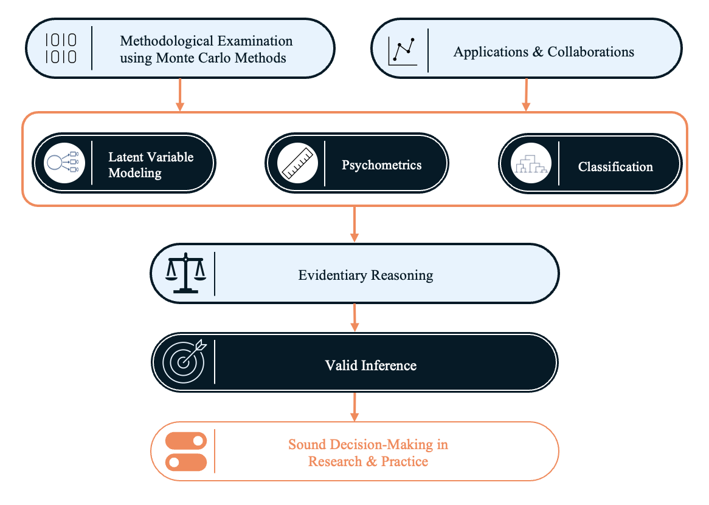

## Methodology, Evidence, and Inference

My scholarship examines how quantitative methods, measurement models, and evidentiary reasoning support defensible conclusions about constructs, models, populations, and consequential decisions.

::: {.research-visual}

{.research-agenda-image}

:::

## A Unified Research Agenda

My scholarship is organized around the validity of inference: how researchers use evidence to reach conclusions about constructs, models, populations, causal relationships, and classifications.

Validity and evidentiary reasoning provide the intellectual framework for this work. Latent variable modeling, psychometrics, and classification are the primary methodological domains in which I investigate that framework.

## Areas of Research

::: {.research-grid}

::: {.research-card}

### Latent Variable Modeling

My work examines the estimation, evaluation, and interpretation of models involving theorized but directly unobservable variables.

Particular areas of interest include structural equation modeling, confirmatory factor analysis, mixture models, model fit, and the consequences of model misspecification.

:::

::: {.research-card}

### Psychometrics and Measurement

My psychometric research focuses on the quality of measurement, the validity of scores and interpretations, and the use of advanced quantitative models to study psychological and educational phenomena.

:::

::: {.research-card}

### Classification

My work in classification focuses primarily on latent or model-based approaches to identifying groups, evaluating class solutions, and understanding the consequences of classification decisions.

:::

::: {.research-card}

### Validity and Evidentiary Reasoning

Across research areas, I examine how design, measurement, analysis, uncertainty, and interpretation combine to support or weaken the conclusions researchers draw from evidence.

:::

:::

## Consequential Validity Lab

### When evidence becomes a decision

An emerging expression of my broader research agenda is the **Consequential Validity Lab**, a collaborative research group focused on the validity of quantitative decisions and the evidentiary processes that support them.

The lab examines the chain connecting **measurement, evidence, interpretation, decisions, and consequences**. Our work asks how measurement error, model uncertainty, classification rules, and analytic choices affect consequential decisions—and what evidence is necessary to justify those decisions.

Research in the lab draws on psychometrics, structural equation modeling, latent-variable models, classification methods, simulation, and validity theory, while remaining centered on a broader question:

> **When quantitative evidence is used to make a decision, what justifies believing that the decision is sound?**

[Explore the Consequential Validity Lab →](consequential-validity-lab.qmd)

## Signature Contributions

::: {.contribution-grid}

::: {.contribution-card}

### Estimation in Categorical Latent Variable Models

Research examining the accuracy and performance of estimation methods under conditions commonly encountered in applied research.

:::

::: {.contribution-card}

### Latent Class and Profile Enumeration

Research investigating how nonnormality, mixed measurement scales, and other data characteristics affect decisions about the number and nature of latent groups.

:::

::: {.contribution-card}

### Model-Fit Evaluation

Research evaluating how fit indices perform across different latent variable models, estimators, sample conditions, and forms of misspecification.

:::

::: {.contribution-card}

### Consequential Inference and Classification

An emerging line of work examining how measurement error, model choice, estimation uncertainty, and classification rules affect consequential decisions about individuals and populations.

:::

:::

## Scholarly Perspective

> Quantitative methods are not simply procedures for analyzing data. They are systems of evidentiary reasoning through which researchers represent phenomena, evaluate uncertainty, and justify conclusions about the world.

## Selected Projects and Collaborations

This section will feature a curated set of methodological and interdisciplinary projects that illustrate my role in measurement, research design, analysis, evaluation, and interpretation.

Project profiles are currently under development.

## Research Impact

My work has contributed to research involving latent variable modeling, psychometrics, classification, model evaluation, and validity.

This section will eventually include selected evidence of scholarly influence, student collaboration, professional recognition, and national review service.

## Selected Resources

A small collection of methodological guides, demonstrations, and research-development resources will be added here.